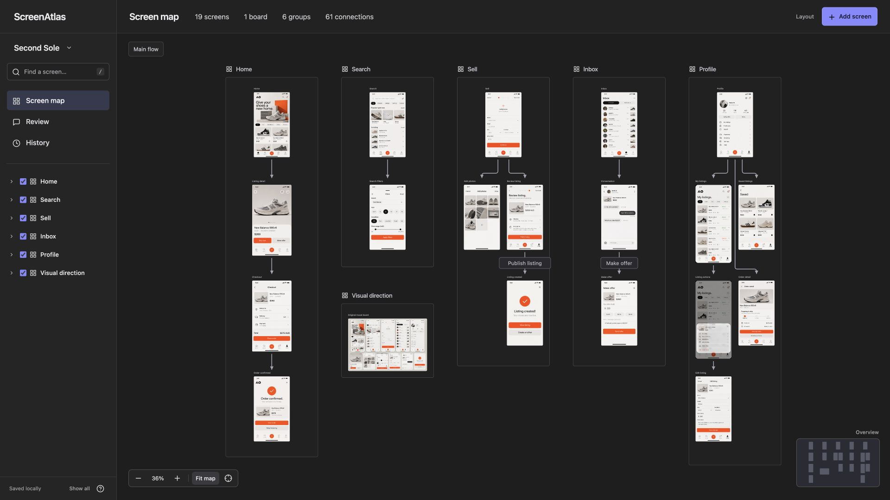

# ScreenAtlas

**Turn reference images into a connected plan for your app.**

ScreenAtlas is a local workspace for generated screens, product contracts,
feedback, and implementation screenshots. Build a map of how your app should
work, then keep the designs and evidence attached as you build it.

Local beta for personal app-design and review workflows.

Python 3.11+, SQLite 3.37+, and plain JavaScript. No accounts, runtime package
dependencies, API keys, frontend build, or hosted services. The code is MIT
licensed. The project was previously called Atlas; existing `atlas` commands,
`atlas.json` projects, and `.atlas-local` review history remain compatible.

## Start your own app

Open this repository in Codex and ask:

> Install and start ScreenAtlas, then guide me through planning my app.

The agent reads your existing app brief when available, or starts with
"What are we building?", then asks for two or three inspiration images. There
is no browser setup or prompt-copying step. The agent generates mood images,
saves your inputs and the results in an **Inspiration** group, and opens the map
for review. Approve a direction before it designs the app screens.

For a manual terminal install:

Download or clone this repository, then open a terminal in its folder. You need
Python 3.11+ with SQLite 3.37+. On macOS or Linux:

```sh
git clone https://github.com/unlostmax/screenatlas.git
cd screenatlas
python3 -m venv .venv
.venv/bin/python -m pip install .
.venv/bin/python -m screen_atlas start ../my-app-map --name "My app"
```

The command prints a short agent handoff. Paste that into Codex and send it as-is;
you can also recover it with `screen-atlas --project ../my-app-map handoff`.
A terminal-only install does not start a Codex conversation automatically.
Codex asks a few questions about your app,
then asks for two or three inspiration images you like. Using its available
image tool, it generates two or three mood images without UI or typography
unless you ask. Review and approve the direction first. Codex then uses those
mood images to design your app screens and import proposals into your map.
Review the first two screens, expand the map, then build your app.

ScreenAtlas works with your app's own screens and navigation, including web,
mobile, and desktop layouts. It does not require the demo's five tabs. Image
generation must be available in your Codex session; you can also supply PNGs.
ScreenAtlas itself runs locally without an image API or account.

**[Full getting-started guide, Windows instructions, and troubleshooting](docs/getting-started.md)**

To explore the optional demo instead:

```sh
.venv/bin/python -m screen_atlas start ../screenatlas-demo --example
```

Run the same `start` command later to reopen a map. Keep the terminal running
while using the app; stop with Ctrl+C. Your work stays saved locally.

## Try the example



```sh
.venv/bin/python -m screen_atlas init ../second-sole --example
.venv/bin/python -m screen_atlas --project ../second-sole serve
```

You can also initialize and serve separately as above. The example opens as five trees on one canvas:
**Home, Search, Sell, Inbox, and Profile** each start their own group, aligned
across the top, with their related screens branching down beneath them.
There is no separate Main tabs group. This layout ships with the example;
new installs do not need to arrange it. Click a group name to focus its tree
without hiding the other groups.
Expand its sidebar arrow to toggle individual screens, or use its checkbox to
show or hide the entire group. **Show all** restores and fits the whole map.

**Second Sole** is a sneaker marketplace example with 19 individual screens,
one original mood-board anchor, five navigation groups plus a separate visual
reference group, and 61 connections. It combines
11 standalone mood-board reconstructions, six generated extensions, and the
two supplied full-size listing references. The three original supplied PNGs
are preserved byte for byte. The generated derivatives are faithful reference
reconstructions, rather than exact pixel crops.

The example includes browsing, search and filters, listing creation, seller
management, negotiation, saved pairs, and checkout. It is a design map, not a
working marketplace or payment app. It contains no fabricated human approvals
or real app captures.


- [Every individual reference](atlas/examples/second-sole/REFERENCES.md)
- [Exact image prompts and digests](atlas/examples/second-sole/prompts.json)
- [A short recording walkthrough](docs/demo-video.md)
- [Screenshot and asset guide](docs/screenshots/README.md)

## Manual project setup

With the ScreenAtlas environment activated, initialization and serving can
also be run separately:

```sh
screen-atlas init /path/to/my-app --name "My app"
screen-atlas --project /path/to/my-app serve
```

Use a new directory for initialization. An empty project starts with one
group. Add screens, edit their contracts and action destinations, then use
**Layout** to arrange the map. **More details** in the inspector contains
connections, screenshot uploads, provenance, and feedback. Placement fields
provide a keyboard alternative to dragging.

The installable distribution and command are `screen-atlas`; the Python
module is `screen_atlas`. The earlier `atlas` and `screen-trellis` commands and
their Python modules remain compatibility aliases. Nothing has been published
to a registry.

## The complete loop

1. Write product behavior and visual direction in separate supporting documents.
2. Inventory screens and states with stable IDs, responsibilities, actions,
   entry conditions, data, edge cases, accessibility, and acceptance examples.
3. Generate a visual reference with the tool available to your agent. Preserve
   the exact prompt, inputs, output, and known provenance.
4. Import it as a registered candidate. Inspect the candidate and curated
   reference; pin feedback with **C** on a screen, image, or canvas location.
5. Read agent replies and preview attachments. Explicitly accept the exact
   candidate, then separately promote it into the portable project references.
6. Implement the application using its own tools. Obtain real screenshots,
   import them with context, and compare them with their frozen references.
7. Record capture-specific appearance decisions and iterate without moving
   old comments or transferring approval to new screenshots.

**Feedback resolution, design acceptance, reference promotion, and screenshot
appearance approval are separate actions.** A screenshot does not establish
behavior, accessibility, physical-device operation, binary provenance, or
release readiness. Map connections describe intended flows.

The browser has a shared canvas, group and screen visibility controls, search, pan/zoom, keyboard
navigation, deep links, a minimap, an inspector, threaded review, proposal
history, screenshot upload, and side-by-side comparison. Group frames keep
related screens together. With no selection, the canvas shows the main forward
flow within each tree. Selecting a screen shows its outgoing connections;
switch to **Incoming** or **All** to explore the other directions, including
cross-tree links and returns. Hover or keyboard-focus an action to isolate its
arrow and show its source, destination, and purpose. **Fit connections** brings
the relevant screens into view. Multiple actions with the same destination
share a directed arrow while retaining every action in the inspector.
Visibility choices stay in your browser and do not change the
project. Hidden screens unmount; offscreen thumbnails unload. Connection
geometry is cached, with viewport culling and obstacle routing for
larger maps.

## Work with Codex or another agent

ScreenAtlas does **not** invoke Codex, Image Gen, a model API, or a generation queue.
It exports context and imports files produced by the tools available to the
agent. If an agent lacks an image-generation tool, you can supply the candidate
yourself. A paid API adapter would be a separate, explicitly configured feature.

The bundled [ScreenAtlas agent skill](atlas/agent-skill/SKILL.md) describes the workflow.
Copy it to a skill folder you choose; ScreenAtlas does not change agent settings:

```sh
screen-atlas agent-skill --output /path/to/skills/atlas-review
screen-atlas --project /path/to/application-atlas context listing-actions
screen-atlas --project /path/to/application-atlas list --status open
screen-atlas new-id
```

CLI output is JSON, except the foreground `start` and `serve` messages. Exit codes
are 0 for success, 1 for storage/runtime errors, 2 for invalid input, and 3 for
revision or identity conflicts. Errors are JSON on stderr. `--help` and
`templates` describe the command interface; [the format reference](docs/format.md)
defines the project and import records.

Every review write requires an **operation UUID**. Keep the operation ID and
payload when retrying an uncertain save. A retry returns the original result;
changing content under the same ID is rejected. Stale revisions require
reading and reconciling concurrent work. Browser drafts are kept separately
from the authoritative SQLite store.

```sh
screen-atlas --project /path/to/application-atlas status THREAD_ID in_progress \
  --revision 1 --operation OPERATION_UUID
screen-atlas --project /path/to/application-atlas reply THREAD_ID \
  --revision 2 --body-file reply.txt --preview candidate.png \
  --status ready --operation ANOTHER_OPERATION_UUID
```

A reply preview is an attachment; it does not register a proposal.

## Import designs

Paths in a manifest are relative to that manifest, or may be absolute local
input paths. ScreenAtlas snapshots PNG bytes immediately. The portable project uses
relative content-addressed asset paths.

```json
{
  "entries": [
    {
      "id": "library-empty",
      "original": null,
      "baselineSha256": null,
      "candidate": "candidate.png",
      "prompt": "The exact prompt submitted to the actual generation tool",
      "source": "Codex Image Gen",
      "reviewNote": "Preserve layout and intentional accent colors",
      "provenance": {
        "tool": "Record the actual tool",
        "inputSha256": [],
        "limitations": ["Static visual guidance only"]
      }
    }
  ]
}
```

```sh
screen-atlas --project /path/to/application-atlas import-proposals proposals.json \
  --operation OPERATION_UUID
screen-atlas --project /path/to/application-atlas proposals
```

For an existing reference, supply its **current curated digest** as
`baselineSha256` and, optionally, its path as `original`. Both are available
from `context SCREEN`. For a new screen, create topology first, then use null
for the baseline and original. New candidates are never implicitly accepted.
Unknown screen IDs do not create topology.

Inspect and accept in the browser. Promotion remains a distinct deliberate
action. The CLI offers equivalent exact-version `accept --reviewed` and
`promote` commands for authorized reviewer workflows; agents must not infer
acceptance. Promotion retains the prompt, provenance, accepted version ID,
acceptance time, prior reference digest, and image dimensions. It never commits
or pushes Git. An interrupted promotion can be retried with its original
operation and payload; the accepted version embedded in the atomic project
document allows the completion record to be recovered.

## Import implementation screenshots

Use the browser's **Add an app screenshot** form or a manifest:

```json
{
  "entries": [
    {
      "id": "fd0391f6-1d22-4444-b91e-9f035d10b821",
      "nodeId": "library-empty",
      "file": "app-screenshot.png",
      "state": "Empty library",
      "source": "simulator",
      "device": "Browser at 390 × 844; OS unknown",
      "buildRevision": "",
      "capturedAt": "",
      "note": "Describe fixtures, transformations, and evidence limitations"
    }
  ]
}
```

```sh
screen-atlas --project /path/to/application-atlas import-captures captures.json \
  --operation OPERATION_UUID
```

The capture UUID, screen ID, state, device/OS, and source are required. Supported
sources are `device`, `simulator`, and `archive`. Build and capture time are
optional; empty build identity stays unknown. A manifest can additionally
provide `referenceSha256` to reject import against an unexpected reference.

Static PNG files are limited to 30 MiB and 24 million pixels, with bounded raster
validation. Animated PNGs are rejected. Imports retain original PNG bytes. If an upstream capture was
cropped, resized, converted, or lossy, record that limitation; never describe a
converted copy as pixel-exact to an unavailable original.

ScreenAtlas stores the matching curated reference snapshot with each capture. Use
side-by-side comparison to approve appearance. The displayed reference and
capture must match their recorded identities. A changed reference prevents
new appearance approval of an old capture; older decisions remain history.
Capture comments pin the exact capture ID and digest. ScreenAtlas does not determine
the installed binary's provenance or automatically run platform scenarios.

## Portable files, private history, and recovery

```text
application-atlas/
  atlas.json                 # Curated inventory, contracts, layout, provenance
  assets/<sha256>.png         # Immutable curated reference images
  docs/product.md            # Optional explicitly linked local documents
  .gitignore                 # Excludes .atlas-local/
  .atlas-local/
    review.sqlite3           # Shared local review authority
    objects/<sha256>.png     # Immutable review images and reference snapshots
    project.lock             # Cross-process write serialization
```

Commit the portable project and desired references in your own repository.
Keep private feedback and application captures out of Git. Retirement preserves
screen identities and history. Normal project edits cannot delete IDs or
change reference approval indirectly; promotion owns reference changes.

```sh
screen-atlas --project /path/to/application-atlas check
screen-atlas --project /path/to/application-atlas doctor
screen-atlas --project /path/to/application-atlas backup /backups/atlas-private.zip
screen-atlas restore /backups/atlas-private.zip /path/to/new-restored-folder
screen-atlas --project /path/to/application-atlas export /exports/atlas.html
```

A **backup** contains project files, declared source documents, SQLite history,
and immutable review images. It is a private, unencrypted ZIP. Restoration
requires a new directory and verifies checksums, schema, database integrity,
references, and review-image availability before completing. No automatic
cleanup deletes old evidence.

An **export** is one self-contained read-only HTML file, including images and
contracts, that opens without a server. It excludes review feedback, candidate
history, and app captures unless `--include-review` is explicitly supplied.
Review curated documents and provenance before distributing any export. ScreenAtlas
does not upload or publish it. Copying only portable project files intentionally
does not transfer private review history; use a full backup when it is needed.

The server binds to loopback and checks Host, Origin, cross-site requests, and
per-server write tokens. It exposes packaged UI files, hash-addressed images,
and explicitly declared text documents, not the project directory tree. This
supports a person and local agents, not authenticated remote collaboration.
Reviewer/agent labels are local attribution rather than verified identities;
hashes and revisions detect corruption and conflicts, not a malicious owner
rewriting all local evidence.

## Development and verification

```sh
python3 -B -m unittest discover -s tests -v
node --check atlas/web/app.js
node --test tests/test_connections.cjs
python3 -m screen_atlas --project atlas/examples/second-sole check
```

Tests use valid PNG rasters and temporary projects. They cover persistence,
concurrent writes, retries, stale acceptance, immutable history, new screens,
reference conflicts, image tampering, capture-specific feedback, independent
appearance decisions, migration checksums, schema drift, promotion recovery,
backup restoration, export privacy, CLI integration, and HTTP boundaries.

The showcase's image generation is performed separately with the built-in image
tool. Exact prompts and input/output digests live in the example. To rebuild only
the portable map from its existing reference files, run:

```sh
python3 -m tools.build_marketplace_example
```

See [contribution guidance](CONTRIBUTING.md), [architecture](docs/architecture.md),
and [MIT license](LICENSE). [NOTICE](NOTICE) credits the original Atlas workflow and example assets.
This initial standalone release starts a new schema history; it does not open
or migrate the original application's private review database. Original
application modules and artwork are not distributed; the sneaker showcase uses
separate supplied and generated design references.
