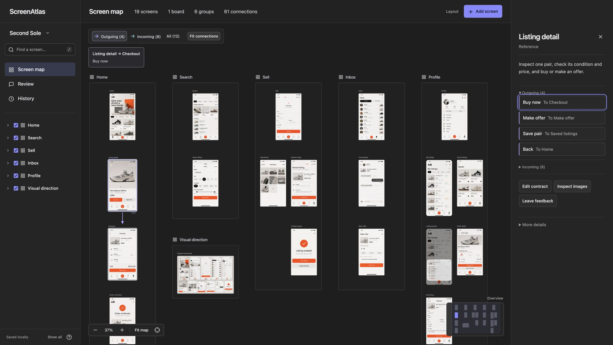

# ScreenAtlas

Plan your app visually, then build it with Codex.

Turn inspiration into screen designs, connect them on one canvas, and give your
agent a shared plan to build from.

## Start in Codex

Open a project in Codex. **Copy and send this message:**

```text
Install and run ScreenAtlas from https://github.com/unlostmax/screenatlas.
Read its AGENTS.md and follow the setup workflow. Use my existing app brief
if available, then guide me through inspiration and screen design.
```

Codex handles setup and asks what you're building. Bring a few images you like;
it helps you explore a direction and opens your map for review.


## From idea to app

1. **Find the mood.** Turn your inspiration into a visual direction you approve.
2. **Map the screens.** Generate designs, connect actions, and leave feedback.
3. **Build and compare.** Have Codex build from the map, then review real app screenshots.



Runs locally. Open source. MIT licensed. Currently in beta.
Image generation needs an available tool in your Codex session; supplied images work too.

Read the [setup guide](docs/getting-started.md), explore the [example](docs/example.md), or browse the [documentation](docs/README.md).
