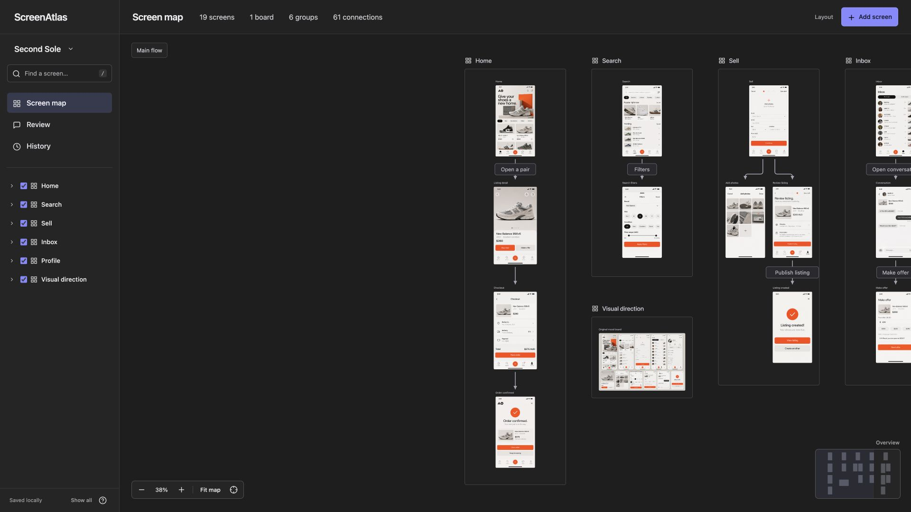

# The Second Sole example

The example opens as five trees on one canvas:
**Home, Search, Sell, Inbox, and Profile** each start their own group, aligned
across the top, with their related screens branching down beneath them.
There is no separate Main tabs group. This layout ships with the example;
new installs do not need to arrange it. Click a group name to focus its tree
without hiding the other groups.
Expand its sidebar arrow to toggle individual screens, or use its checkbox to
show or hide the entire group. **Show all** restores and fits the whole map.

**Second Sole** is a sneaker marketplace example with 19 individual screens,
one original mood-board anchor, five navigation groups plus a separate visual
reference group, and 61 connections. It combines
11 standalone mood-board reconstructions, six generated extensions, and the
two supplied full-size listing references. The three original supplied PNGs
are preserved byte for byte. The generated derivatives are faithful reference
reconstructions, rather than exact pixel crops.

The example includes browsing, search and filters, listing creation, seller
management, negotiation, saved pairs, and checkout. It is a design map, not a
working marketplace or payment app. It contains no fabricated human approvals
or real app captures.

- [Every individual reference](../atlas/examples/second-sole/REFERENCES.md)
- [Exact image prompts and digests](../atlas/examples/second-sole/prompts.json)
- [A short recording walkthrough](demo-video.md)
- [Screenshot and asset guide](screenshots/README.md)

Start it with `screen-atlas start ../screenatlas-demo --example` from an activated ScreenAtlas environment.
